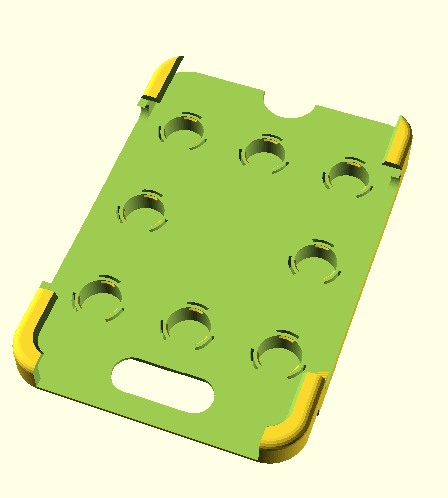
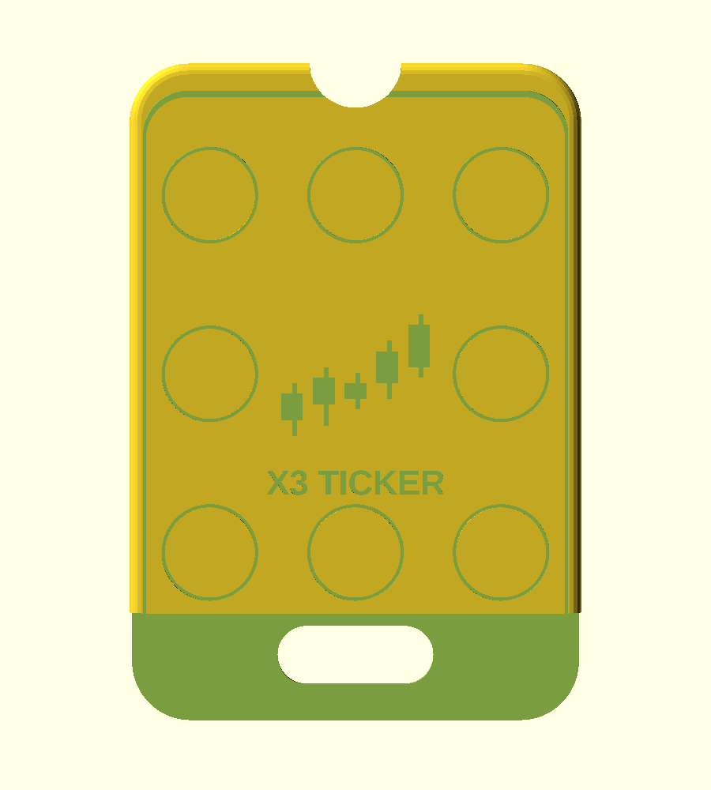

# Xteink X3 fridge-magnet case (v2.2)

A printable open-frame case that turns an Xteink X3 into a fridge/door ticker. **Eight N52 10 x 3 mm
neodymium disc magnets snap into pockets on the back, no glue needed**, hidden behind a 0.6 mm skin.

 

## Files
- `x3_case.scad` - parametric OpenSCAD source (edit the values at the top)
- `x3_case.stl` - ready to print (v2.2)
- `x3_magnet_test.stl` - small 2-pocket coupon: print it first to check the magnet snap fit
- `old/` - earlier prototypes (v1 is in the git history)

## What's new in v2.2
- **8 magnets**: two side columns of 3, plus top-centre and bottom-centre.
- **Charging recess**: the bottom 17 mm of the back is recessed edge to edge (5.35 mm deep) from the
  fridge side, with a small 24 x 9 mm hole for the plug's contact nose over the X3's 4-pin pogo connector.
  The plug body sits flush wherever it lands and the cable can leave to either side or straight down.
  This replaces v2.1's through-notch, the same way other X3 cases use a small rear opening.
- Wider bottom opening (52 mm) so the corner lips stay clear of the front rocker bars.
- Cleanups: removed dead code, fixed stale comments, regenerated the test coupon.

## Status: untested
Not yet test-printed or fitted to a real device. Dimensions come from the manufacturer spec
(97.6 x 63.7 x 5.1 mm). Button and connector positions were estimated from photos of other X3 cases
(about +-2 mm), not measured on a device. The case only grips the four corners and leaves the sides,
top and bottom centre of the front open. Nothing stops the X3 sliding out of the top; on a fridge,
gravity keeps it seated.

Charging plug limits: its body must be at most about 5.3 mm thick (recess depth) and its contact nose
must reach through the 0.8 mm plate (`pogo_skin`). The bottom corner lips sit on that 0.8 mm plate,
so they are less stiff than the rest of the frame; raise `pogo_skin` if needed.

## Print
Back-down, 0.2 mm layers or finer. **Supports: build plate only, for the bottom charging recess**
(it is open on three sides). The rest prints without supports. **PETG recommended**: the magnet catches
flex once on insertion (hand estimate about 1.4% strain), which PLA may not tolerate.
Tune `clr` (device clearance per side) and `catch_prot` (magnet catch overlap) after a test print.

## Assembly
1. Press the 8 magnets into the back pockets from the cavity side, all with the same face outward
   (check polarity against the X3's own back magnet). They click past the lips.
2. Slide the X3 in from the top, bottom edge first. A thumb notch at the top lets you push it out from behind.
3. To charge, attach the magnetic plug through the hole in the bottom recess.

To remove a magnet, push it out from the outside by piercing the thin skin, or spread a catch with a pick.
N52 is strong but brittle; keep it below ~60 C and don't let two magnets slam together.
